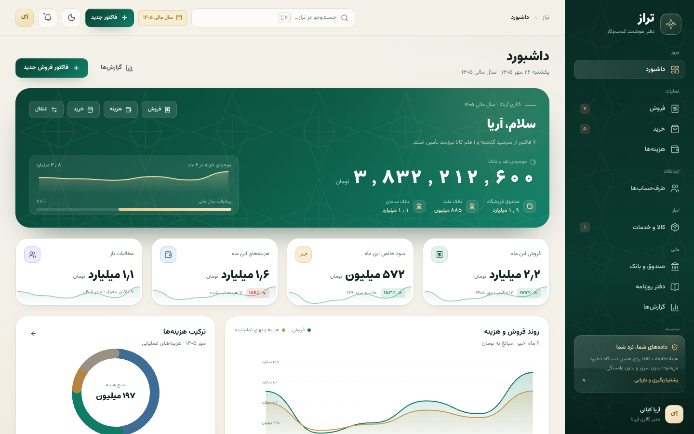
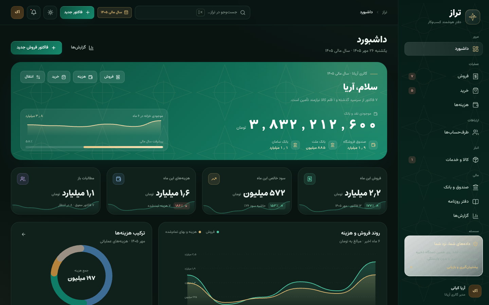
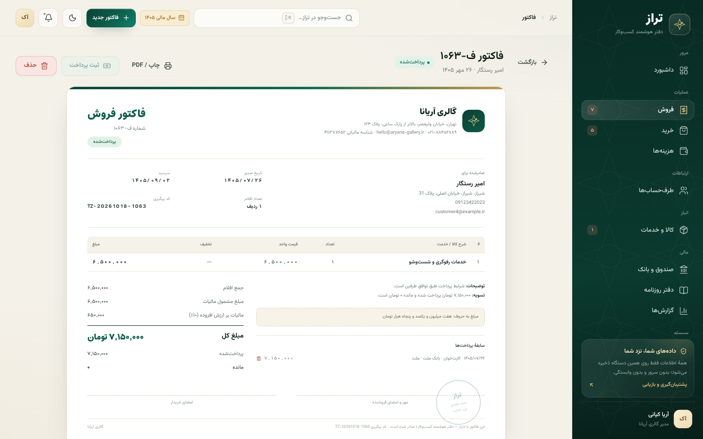
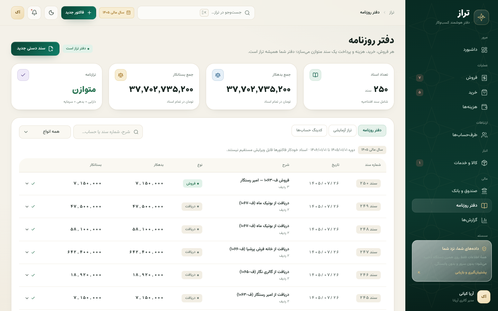
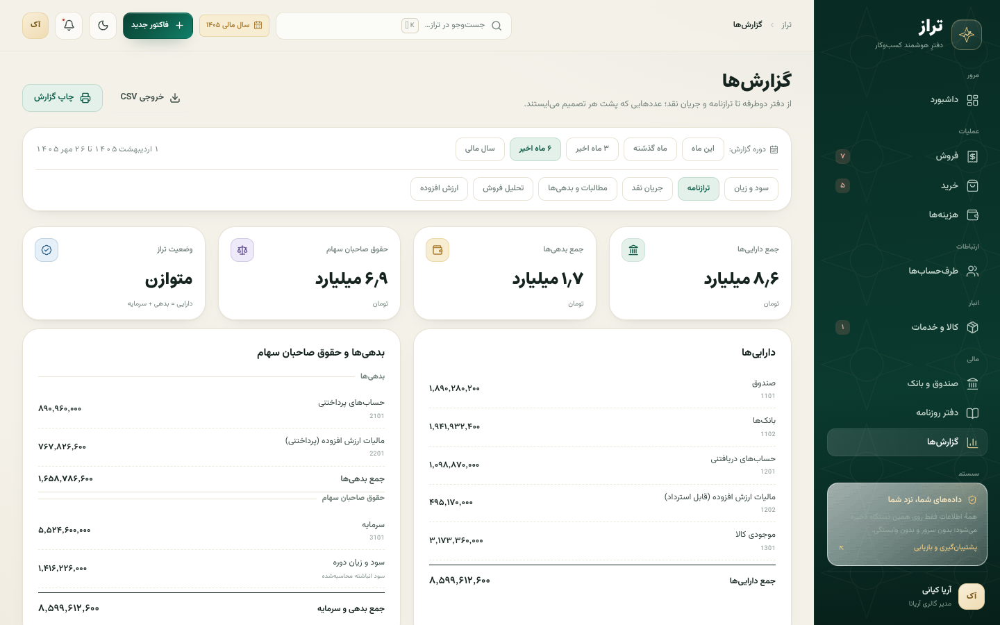

<div align="center">


# تراز — دفترِ هوشمند کسب‌وکار

**حسابداری دوطرفه، زیبا و ایرانی — بدون سرور، بدون وابستگی، روی همین دستگاه.**

</div>

---

## این برنامه چیست؟

**تراز** یک اپلیکیشن حسابداری کامل برای کسب‌وکارهای ایرانی است: از صدور فاکتور و ثبت خرید و هزینه تا دفتر روزنامهٔ دوطرفه، تراز آزمایشی، ترازنامه، صورت سود و زیان، جریان نقد، سنی‌سازی مطالبات و گزارش ارزش افزوده.

همه چیز با **تاریخ شمسی**، **اعداد فارسی**، **راست‌به‌چپ** و واحد **تومان** طراحی شده — نه به‌عنوان یک افزونه، بلکه از پایه.

| | |
|---|---|
| **دوطرفهٔ واقعی** | هر فروش، خرید، هزینه، دریافت، پرداخت و انتقال وجه، سند حسابداری خودکار تولید می‌کند. |
| **آفلاین و خصوصی** | داده‌ها در `localStorage` همان دستگاه ذخیره می‌شوند؛ هیچ سروری در میان نیست. |
| **دو تم آماده** | «کاغذ و زمرد» (روشن) و «شب و طلا» (تیره)، با سیستم طراحی واحد. |
| **دادهٔ نمونهٔ زنده** | یک گالری فرش و صنایع دستی («گالری آریانا») با هفت ماه گردش واقعی برای گشت‌وگذار. |
| **قابل توسعه** | لایهٔ دامنه، دفتر کل و کاتالوگ حساب‌ها از رابط کاربری جدا هستند تا صنف‌های بعدی به‌سادگی اضافه شوند. |

---

## نگاهی به برنامه

| داشبورد (روشن) | داشبورد (تیره) |
| --- | --- |
|  |  |

| فاکتور فروش | دفتر روزنامه | گزارش‌ها |
| --- | --- | --- |
|  |  |  |

---

## امکانات

### عملیات فروش و خرید
- فاکتور فروش و خرید با چند ردیف کالا/خدمت، تخفیف ردیفی، تخفیف کل و مالیات بر ارزش افزودهٔ قابل‌تنظیم.
- وضعیت پرداخت زنده: **پرداخت‌شده، پرداخت جزئی، در انتظار پرداخت، سرسید گذشته**.
- سرسید (مهلت پرداخت)، شمارهٔ خودکار فاکتور، شمارهٔ پیگیری و کد رهگیری چاپ.
- ثبت دریافت/پرداخت جزئی و چندمرحله‌ای روی هر فاکتور، با انتخاب حساب و روش پرداخت.
- مدیریت موجودی انبار بر پایهٔ فاکتورها، بهای تمام‌شده و هشدار کمبود موجودی.

### هزینه‌ها
- دسته‌بندی‌های آماده (اجاره، حقوق، بازاریابی، حمل، آب و برق و…)، ثبت از حساب، طرف‌حساب دریافت‌کننده و توضیحات.
- تحلیل ترکیب هزینه‌ها با نمودار دونات و روند ماهانه.

### طرف‌حساب‌ها
- مشتریان و تأمین‌کنندگان با مانده حساب، گردش خرید/فروش و سابقهٔ فاکتورها.
- پروفایل کامل هر طرف‌حساب در کشوی جزئیات، با اقدام سریع «فاکتور جدید».

### خزانه‌داری
- چند حساب نقدی و بانکی با شمارهٔ کارت/شبا، موجودی و گردش.
- انتقال وجه بین حساب‌ها با ثبت خودکار سند.
- دفتر گردش هر حساب با ماندهٔ تجمعی.

### حسابداری
- **دفتر روزنامهٔ دوطرفه** با اسناد شماره‌دار (فروش، خرید، هزینه، دریافت، پرداخت، انتقال، سند دستی).
- **تراز آزمایشی** و **کدینگ حساب‌ها** (دارایی جاری/غیرجاری، بدهی، سرمایه، درآمد، هزینه).
- **سند دستی** با اعتبارسنجی بدهکار = بستانکار و ابزار «تراز خودکار».
- **دفتر معین** هر حساب با گردش و مانده.

### گزارش‌ها
- صورت سود و زیان، ترازنامه، جریان نقد ماهانه، سنی‌سازی مطالبات/بدهی‌ها، تحلیل فروش و ارزش افزوده.
- محدودهٔ زمانی: این ماه، ماه قبل، ۳ ماه، ۶ ماه، سال مالی.
- خروجی CSV (سازگار با اکسل، با BOM و کاراکترهای فارسی) و چاپ/PDF با سربرگ گزارش.

### سیستم
- هویت کسب‌وکار (نام، مدیر، شناسهٔ مالیاتی، نشانی، تماس) که در فاکتورها و گزارش‌ها به‌کار می‌رود.
- سال مالی، واحد پول، نرخ پیش‌فرض مالیات و نمایش اعداد فارسی.
- **پشتیبان‌گیری کامل JSON** و بازیابی آن، بازنشانی دادهٔ نمونه و پاک‌سازی کامل.
- جست‌وجوی سراسری با `Ctrl/⌘ + K`، اعلان‌های هوشمند و چاپ فاکتور با طراحی اختصاصی.

---

## اجرا

```bash
# نصب وابستگی‌ها
npm install

# نسخهٔ دسکتاپ (Electron + Vite)
npm run dev

# پیش‌نمایش وب همان رابط کاربری
npm run dev:web        # http://localhost:5173

# ساخت نسخهٔ دسکتاپ / نصب‌کننده‌ها
npm run build
npm run build:win | build:mac | build:linux
```

> **یادداشت:** `npm install` به‌طور پیش‌فرض باینری Electron را از شبکه دانلود می‌کند. اگر شبکه محدود است، از `npm install --ignore-scripts` استفاده کنید و پیش‌نمایش وب (`npm run dev:web`) را اجرا کنید؛ رابط کاربری کاملاً کار می‌کند.

### پشتهٔ فنی

| لایه | انتخاب |
| --- | --- |
| پوستهٔ دسکتاپ | Electron ۳۹ + electron-vite |
| رابط کاربری | React ۱۹ + TypeScript ۵.۹ + Vite ۷ |
| حالت (State) | Zustand ۵ با `persist` روی `localStorage` |
| انیمیشن | Framer Motion ۱۲ |
| آیکون‌ها | Lucide |
| فونت‌ها | Vazirmatn (متن) + Estedad (تیتر و اعداد) — بسته‌بندی‌شده در برنامه |
| استایل | CSS دست‌نویس با توکن‌های طراحی (بدون کلاس‌های سرگردان) |

### ساختار پروژه

```
src/
├── main/index.ts           ← فرایند اصلی Electron (پنجره، امنیت، آیکون)
├── preload/                ← پل امن `window.taraz`
└── renderer/
    ├── index.html          ← RTL، تم اولیه پیش از رندر، CSP
    └── src/
        ├── domain/         ← تایپ‌ها، کاتالوگ حساب‌ها، محاسبات، ساخت دفتر روزنامه
        ├── lib/            ← تاریخ شمسی، اعداد، قالب‌بندی، خروجی فایل
        ├── store/          ← Zustand (دادهٔ نمونه، CRUD، تنظیمات، UI)
        ├── components/     ← کیت رابط کاربری، نمودارها، تاریخ‌گزین، مودال‌ها
        ├── pages/          ← داشبورد، فروش، خرید، هزینه‌ها، طرف‌حساب‌ها، …
        └── assets/         ← سیستم طراحی (styles.css)
```

---

## مدل حسابداری

تراز از **دفتر کل دوطرفه** استفاده می‌کند. هر رویداد مالی به یک `JournalDoc` تبدیل می‌شود که ردیف‌های بدهکار/بستانکار آن همیشه مساوی‌اند:

| کد | حساب | نوع |
| --- | --- | --- |
| ۱۱۰۱ | صندوق | دارایی جاری |
| ۱۱۰۲ | بانک‌ها | دارایی جاری |
| ۱۲۰۱ | حساب‌های دریافتنی | دارایی جاری |
| ۱۲۰۲ | مالیات ارزش افزوده (قابل استرداد) | دارایی جاری |
| ۱۳۰۱ | موجودی کالا | دارایی جاری |
| ۲۱۰۱ | حساب‌های پرداختنی | بدهی جاری |
| ۲۲۰۱ | مالیات ارزش افزوده (پرداختنی) | بدهی جاری |
| ۳۱۰۱ | سرمایه | حقوق صاحبان سهام |
| ۴۱۰۱ | درآمد فروش | درآمد |
| ۵۱۰۱ | بهای تمام‌شده کالای فروش‌رفته | هزینه |
| ۶۱۰۱–۶۱۹۹ | هزینه‌های عملیاتی | هزینه |

**قاعدهٔ طلایی:** ترازنامه همیشه متوازن است؛ هر سند به‌صورت اتمی ثبت یا حذف می‌شود و حذف یک فاکتور، اسناد مرتبط را نیز برمی‌دارد.

---

## داده‌ها و حریم خصوصی

- همهٔ داده‌ها در `localStorage` با کلید `taraz-ledger-v1` ذخیره می‌شوند.
- هیچ درخواست شبکه‌ای، هیچ حساب کاربری و هیچ تلمتری وجود ندارد.
- برای انتقال یا آرشیو، از **تنظیمات ← دانلود پشتیبان** استفاده کنید (فایل JSON کامل).
- برای شروع تازه، **بازنشانی دادهٔ نمونه** یا **پاک‌سازی کامل** در همان صفحه در دسترس است.

---

## طراحی

- **رنگ‌ها:** زمرد عمیق `#0b3229`، کاغذ گرم `#f4f1e9`، طلای مهارشده `#D7B56E`.
- **تایپوگرافی:** Vazirmatn برای متن، Estedad برای اعداد و تیترها؛ ارقام فارسی به‌صورت پیش‌فرض.
- **حرکت:** انتقال نرم صفحه‌ها، شمارنده‌های نرم، اسپلش کوتاه یک‌بار در هر نشست.
- **واکنش‌گرایی:** سایدبار کامل ← ریل آیکونی ← کشوی موبایل، با حفظ خوانایی جدول‌ها.

---

<div align="center">

**تراز** — چون حساب‌وکتاب باید هم دقیق باشد، هم دیدنی.

</div>
